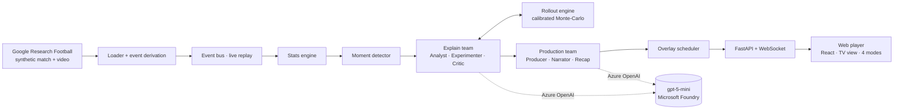

# Sliding Doors

**One match. Millions of fans. Every one of them gets their own broadcast — and every insight is proven, not guessed.**

Sliding Doors is an AI match-intelligence layer that runs alongside a live football match. It ingests match events,
turns them into football statistics, explains *why* key moments mattered, and renders timed, machine-readable
overlays that look genuinely different for an analyst, a club fan, a fan following one player, or a casual viewer —
in their language.

Its signature feature: at every key moment it **replays the match from that exact game state hundreds of times**
and compares the real decision with the alternatives. AI agents form hypotheses ("the assist was the best option",
"tighter marking would have prevented the goal") and *test* them in a simulator before anything reaches the screen.
Every number on screen comes from code, never from a language model.

> Built for the *Inside the Game* hackathon (Premier League × Microsoft), challenge *The Synthetic Match Insights
> Engine for Premier League Studio*. All data is synthetic; clubs and players are fictional.

**Live demo:** https://ca-web-ym7yowlldzrcg.happymoss-fe33e89e.swedencentral.azurecontainerapps.io/
(scales to zero — the first load can take ~15 s)

---

## What it does — the five stages of the brief

| Stage | In Sliding Doors |
|---|---|
| **a · Ingest** | A synthetic match (positions of all 22 players + ball, 10× per second) is streamed in match time; events are derived live — passes, shots, tackles, interceptions, pressure, carries, set pieces, goals — and published only once their outcome is knowable (no look-ahead). |
| **b · Interpret** | Stats engine: possession, pass accuracy, **pass difficulty** (distance, lane, receiver marking, pressure), threat gain, xG, **ball and shot speed**, player speed and sprints, **pressure index**, **control vs chaos**, **game rhythm**. |
| **c · Explain** | A deterministic moment detector picks goals, big chances, decisive passes and dangerous turnovers. The **explain team** (Analyst → Experimenter → Critic) runs counterfactual simulations and keeps only findings that are meaningful, stable across seeds and football-plausible. |
| **d · Render** | An overlay scheduler turns insights, stats, alerts and recaps into **timed, machine-readable overlays** (`start_ms`, `duration_ms`, slot, priority, payload, evidence) — the format a broadcast rendering partner consumes. Max two on screen, insights only in dead-ball windows, freshest key moment first. |
| **e · Personalise** | The **production team** (Producer → Narrator → Recap) works per *segment* (mode × club × player × language), not per viewer, so cost is independent of audience size. Four genuinely different experiences, chosen on first visit and switchable any time. |

### Four viewers, one moment

| Mode | What you see |
|---|---|
| **Analyst** | Data HUD (control vs chaos, pressing, rhythm, last pass difficulty, xG), full Sliding Doors card with probabilities, ghost futures and every tested hypothesis. |
| **Club fan** | Your club's colours, partisan language ("we"), momentum, big goal banners — and Sliding Doors only for your team's key moments, as one line. |
| **Player focus** | The camera follows your player; live card with speed, top speed, pass accuracy, heatmap; his decisions rated ("best of 3 options"). |
| **Big moments** | Score, goals and big chances only, one line on why each one mattered, full-time recap. |

The **Producer view** shows three viewers side by side at the same moment — the same intelligence, three
different broadcasts. Languages: English, German, Spanish.

## How Sliding Doors works

```
key moment (e.g. 50', decisive pass)
   │
   ├─ Experiment menu (code): "had shot", "had passed to X", "had carried", "defender Y 5 m closer" …
   ├─ Analyst (LLM agent): may probe the simulator via tools, picks 1–3 hypotheses from the menu — it cannot invent physics
   ├─ Experimenter (code): 500 simulated futures × 3 seeds per hypothesis vs. what really happened
   ├─ Critic (LLM): accepts or rejects; hard rules overrule it
   │     · effect ≥ 1.5 points and larger than the seed noise
   │     · football prior (tighter marking may not help the attacker)
   │     · every number in the claim must be one we computed — otherwise a template is used
   └─ one retry with the rejected hypotheses as feedback
```

Goals are explained through the **assist** ("what made it possible"), solo goals from the defending side;
turnovers are judged on the chance to **keep the ball**, attacking moments on the chance to **score**.

## Agent architecture

The agents run on the **Microsoft Agent Framework** (`agent-framework-core` 1.23 + `agent-framework-openai`,
[`backend/app/agents/framework.py`](backend/app/agents/framework.py), [`workflow.py`](backend/app/agents/workflow.py)).

- **Framework agents.** Analyst, Critic, Producer, Narrator and Recap are each an `agent_framework.Agent` on an
  Azure OpenAI chat-completions client (deployment `fast` = gpt-5-mini, keyless via `DefaultAzureCredential`).
  Every agent answers with a pydantic schema as structured output (`AnalystPlan`, `CriticReview`, `NarratorDraft` …).
- **Function tools.** The Analyst gets two tools bound to the moment: `get_match_stats()` (score, shots, passes,
  pressure on the player on the ball, computed by code) and `run_experiment(experiment_id)` (runs one menu
  experiment in the rollout engine, 500 futures × 3 seeds). The tool refuses ids that are not on the remaining
  menu and stops after 4 experiments per round. In the demo match the Analyst made 38 `run_experiment` and
  11 `get_match_stats` calls across 9 moments.
- **Workflow.** The explain team is a framework `Workflow` with explicit hand-offs and a retry loop:

  ```
  analyst ──> experimenter ──> critic ──(nothing claimable, round left)──> analyst
     └──(menu used up)──> finalize <──(no hypothesis)──┘  └──(done)──> finalize ──> Insight
  ```

  `experimenter` and `finalize` are code executors. The production team (Producer → Narrator, Recap) runs the same
  framework agents per viewer segment.
- **Guards stay in code.** Both runtimes call the same step functions: menu restriction, `passes_rule` (effect ≥ 1.5
  points and above the seed noise) and `plausible` (football prior) overrule the Critic, `numbers_are_ours` +
  player-id check on every LLM text, template fallback for the claim and for Narrator/Recap texts.
- **Offline and replayable.** `LLM_PROVIDER=fake` swaps in a deterministic fake chat client that still drives the
  framework's tool loop (tests and offline demos need no network). A chat middleware caches every model call
  (`LLM_CACHE=readwrite|replay|off`); on replay the tools simply run again as code. `AGENT_RUNTIME=sdk` selects
  the original hand-written loop on the plain OpenAI SDK. Both runtimes give identical insights on the fake model
  and share the single-turn cache entries.

## Architecture



### Microsoft / Azure technologies

| Technology | Role |
|---|---|
| **Microsoft Agent Framework** (Python) | Agents with function tools and structured outputs; explain team as a workflow with a Critic-gated retry loop |
| **Azure OpenAI in Microsoft Foundry** (gpt-5-mini) | All agents (Analyst, Critic, Producer, Narrator, Recap) with structured outputs; **keyless** access via Microsoft Entra ID (`DefaultAzureCredential` + RBAC role), no API keys anywhere |
| **Azure Container Apps** | Hosts the single container (API + web player + baked match data), scale 0–1 |
| **Azure Container Registry** | Image registry, pulled with a managed identity |
| **Application Insights + Log Analytics** | OpenTelemetry tracing of the API, ingestion capped at 1 GB/day |
| **Azure Developer CLI + Bicep** | Infrastructure as code, one-command deploy (`azd up`), see [`infra/README.md`](infra/README.md) |

Production path: the deployed app only *serves* pre-computed exports; agent runs happen in the pipeline and are
cached (`data/cache/llm/`), so the demo replays deterministically without model calls. Live mode is switchable.

## Measurements

| What | Result |
|---|---|
| Rollout engine | ~1,700 simulated futures per second (500 futures in ~0.3 s) |
| Calibration vs. GRF (150 real game states, 15 s horizon) | goals per possession **0.060 vs 0.060**, tackles/15 s 0.67 vs 0.70, passes/15 s 3.6 vs 3.1, turnovers 0.88 vs 0.77 |
| Decision sanity gate | inside 12 m, shooting beats dribbling at all 6 test spots (e.g. penalty spot 24 % vs 17 %) |
| Explain team | ~10–30 s per key moment with gpt-5-mini (Agent Framework workflow incl. tool calls), 9 key moments in the demo match |
| Unverified numbers on screen | 0 — the backend validates every claim, the web player re-audits every % against the rollouts |
| Tests | 116 backend tests (pytest), `ruff` + `mypy` clean; frontend `eslint` + `tsc` clean |

## Synthetic data

- **Google Research Football** is used purely as a physics-based football simulator (no reinforcement learning):
  bot-vs-bot matches yield the positions of all 22 players and the ball 10× per second.
- An own scenario balances the teams and runs in **deterministic mode**; the demo match is rendered to video and
  recorded **in the same pass**, so every video frame matches its data frame.
- GRF plays 5 minutes of football on a 90' broadcast clock. The UI therefore shows only duration-independent
  numbers (shares, rates, speeds, probabilities), never totals like kilometres run.

## Run it locally

```bash
# backend
cd backend && python3 -m venv .venv && .venv/bin/pip install -e ".[dev]" && .venv/bin/python -m pytest
# web player (opens the demo match, no backend needed)
cd frontend && npm install && npm run dev
# full pipeline for a recorded match (offline with LLM_PROVIDER=fake, or azure with az login)
LLM_PROVIDER=azure backend/.venv/bin/python spikes/explain_demo.py spikes/grf/out/matches/demo-109 data/insights/demo-109.json
```

Recording new matches needs Docker (GRF, see [`CLAUDE.md`](CLAUDE.md)); deploying: [`infra/README.md`](infra/README.md).

## Honest limitations

- The rollout engine is a simple calibrated model, not a physics engine: it still over-predicts turnovers
  (~0.88 vs 0.77), so Sliding Doors only makes **comparative** claims ("clearly better than"), never exact forecasts.
- In production the simulator would be calibrated on real tracking data, and fans would pick their real
  Premier League club; the demo uses two fictional clubs because only synthetic data is allowed.
- GRF draws player names into its video that cannot be fully covered by our overlays.
- The demo serves pre-computed (cached) agent output for reliability; the live agent path takes 10–20 s per moment,
  which fits a broadcast replay window but not an instant reaction. The Analyst's tool calls make a run slower
  than the plain loop (53 model calls for 9 moments instead of ~27).

## Repository

```
backend/    FastAPI, stats, rollout engine, agents, overlays (Python 3.12)
frontend/   web player (React + Vite + TypeScript)
infra/      azd + Bicep for Azure Container Apps
spikes/     GRF Docker image, recorder/renderer, pipeline scripts
data/       insights + LLM cache (match exports and videos are generated)
docs/       plan, handoff, devil's-advocate review
```
